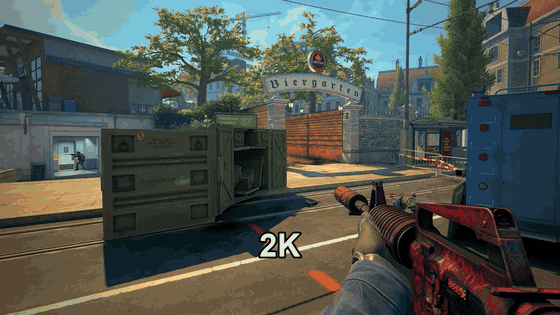

# Fragsmith

**Turn a CS2 demo into a finished fragmovie. Automatically.**

[](LICENSE)




Point Fragsmith at a `.dem` file. It finds your best rounds, renders them from your point of view, cuts them to the beat of your music, adds slow-mo, zooms and overlays, and hands you an mp4. No video editor needed.

## Features

- **Finds the highlights.** Multikills, aces, won clutches (detected from who's alive, not guessed), knife, zeus and AWP headshot moments.
- **Picks the order like an editor would.** Strong opener, build-up, best clip last. Use the built-in rules for free, or let Claude direct the film.
- **Cuts on the beat.** Every cut snaps to the music, and the climax lands on the track's bass drop.
- **Real slow-mo.** Slow-motion clips are rendered at 120 fps, so they're smooth instead of stuttery.
- **Effects that hit the kills.** Kill zoom, dutch tilt, headshot punch, freeze frame, kill counter, instant replay from the victim's POV, letterbox, color grade, film grain, whooshes and impacts with music ducking. All of them can be turned on or off: [docs/effects.md](docs/effects.md).
- **You stay in control.** Fragsmith stops after the edit plan and shows what it will render and how long it'll take. Nothing renders until you say so. Every film comes with a `report.md` explaining the choices.
- **One PC or two.** Render on your own PC, or hand rendering to a second PC and keep using your main one.

## How it works

| Step | What | Tool |
|---|---|---|
| 1 | Parses the demo: kills, headshots, weapons, rounds | [demoparser2](https://github.com/LaihoE/demoparser) |
| 2 | Scores every kill cluster for hype | built-in rules |
| 3 | Picks clips, order, slow-mo and overlay text | built-in rules or Claude |
| 4 | Renders the clips from your POV | [CS Demo Manager](https://cs-demo-manager.com) + [HLAE](https://www.advancedfx.org) |
| 5 | Finds the beats and the drop in your music | librosa |
| 6–7 | Cuts, effects, music mix → `final.mp4` | ffmpeg |

## Setup

You need Windows, [Python 3.11+](https://www.python.org/downloads/), [ffmpeg](https://ffmpeg.org/download.html), CS2 and [CS Demo Manager](https://cs-demo-manager.com). Open CS Demo Manager once and finish its setup wizard.

```
git clone https://github.com/duffarn-dev/fragsmith.git
cd fragsmith
python -m venv .venv
.venv\Scripts\pip install -r requirements.txt
.venv\Scripts\python main.py setup
.venv\Scripts\python main.py doctor
```

`setup` asks for your SteamID64, your music folder and which PC renders, then writes `config.toml`. `doctor` checks that everything is installed and tells you what's missing. You can also copy `config.example.toml` to `config.toml` and edit it by hand.

### One PC or two?

Rendering launches CS2 and takes over that PC's screen while it plays back the demo.

- **One PC** (`[render].mode = "local"`, the default): `render` runs CS2 right on your PC. Nothing else to set up.
- **Two PCs** (`"ssh"` or `"folder"`): a second PC with CS2 runs `worker.py` and renders while you keep using your main PC. See [docs/two-pc-setup.md](docs/two-pc-setup.md).

### Claude or rules?

Step 3 (picking the clips, their order, slow-mo and overlay text) works two ways:

- **Built-in rules** (free, offline): aces, 3k+ and clutches are always in, the best clip ends the film, slow-mo goes on the biggest kills. Same plan every time for the same demo.
- **Claude** (needs an Anthropic API key, billed per film by Anthropic): reads the whole match, makes more varied choices, writes the overlay text and explains every decision in `report.md`.

By default (`[director].mode = "auto"`), Fragsmith uses Claude if it finds an `ANTHROPIC_API_KEY` and the rules otherwise. To use Claude, put the key in a `.env` file in the project folder:

```
ANTHROPIC_API_KEY=sk-ant-...
```

Force one or the other for a single run with `--director rules` or `--director claude`.

## Usage

```
python main.py run <demo.dem>        # steps 1–3, shows the edit plan and stops
python main.py render runs/<id>      # step 4, renders the clips (your approval)
python main.py finish runs/<id>      # steps 5–7, creates final.mp4 + report.md
python main.py batch <folder>        # steps 1–3 for every demo in a folder
python main.py cleanup runs/<id>     # deletes raw clips and intermediate files
```

Valve matchmaking demos (`.dem.bz2`) are extracted automatically. Use `--player <steamid64>` to make a film of someone else in the demo, and `finish --music <file>` to try a different track without rendering again.

## FAQ

**Can this get me VAC banned?**
Fragsmith never touches a running game. Rendering is done by CS Demo Manager, which launches its own CS2 in `-insecure` mode (VAC off) to play back the demo, then closes it. Don't queue for matchmaking while a render is running.

**Why won't my old demos render?**
CS2 only plays back demos from the same or a close game version. Old demos can still be analyzed, but not filmed. Render your matches while they're fresh. See [docs/troubleshooting.md](docs/troubleshooting.md).

**How long does a film take?**
Rendering takes roughly twice the length of the chosen clips, plus a couple of minutes for CS2 to start. `run` shows an estimate before anything renders. Editing and assembly take a few minutes more.

**Can I use my own music, LUT or sound effects?**
Yes. Music comes from your own folder. Point `[effects].lut` at any `.cube` file, and drop your own `whoosh.wav`/`impact.wav` into `assets/sfx/`. The included LUT and sound effects are generated by Fragsmith itself, so they're free to use.

## Limitations

- `.dem` input only, not raw video.
- Music from a local folder only.
- Player POV only, no cinematic camera paths.
- Windows only, because CS Demo Manager and HLAE are.
- CS2 updates sometimes break HLAE for a few days. Updating CS Demo Manager usually fixes it.

## Documentation

- [docs/effects.md](docs/effects.md): every effect and its config flag
- [docs/two-pc-setup.md](docs/two-pc-setup.md): rendering on a separate PC
- [docs/troubleshooting.md](docs/troubleshooting.md): known issues
- [docs/dev-notes.md](docs/dev-notes.md): notes for contributors
- [CONTRIBUTING.md](CONTRIBUTING.md): how to help

## License and credits

Fragsmith is released under the [MIT License](LICENSE).

It stands on the shoulders of [demoparser2](https://github.com/LaihoE/demoparser), [CS Demo Manager](https://github.com/akiver/cs-demo-manager), [HLAE](https://www.advancedfx.org), [ffmpeg](https://ffmpeg.org) and [librosa](https://librosa.org). None of them are bundled: you install them separately, under their own licenses.

Fragsmith is not affiliated with or endorsed by Valve. Counter-Strike is a trademark of Valve Corporation.
